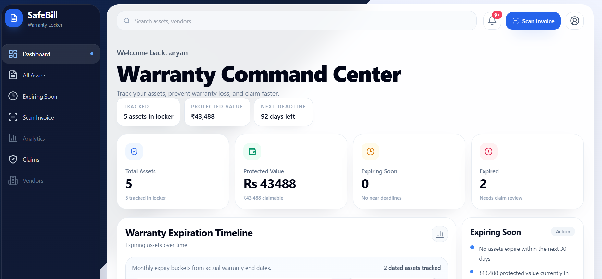
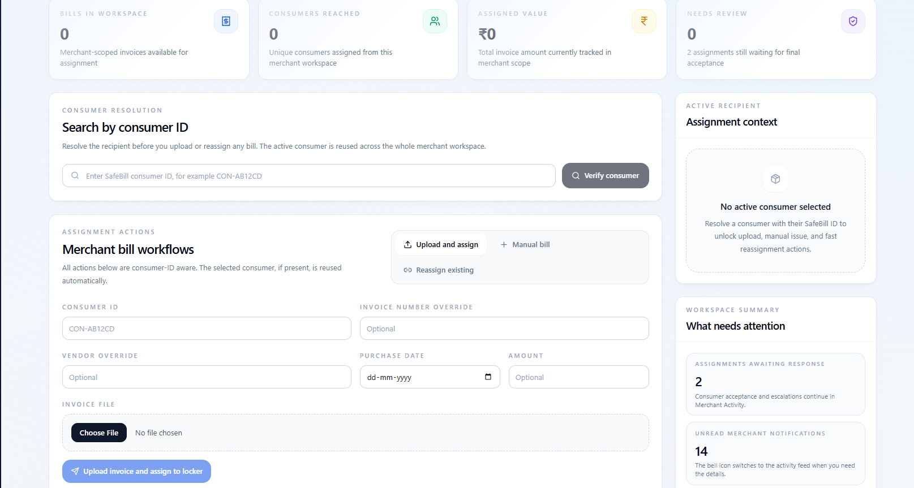
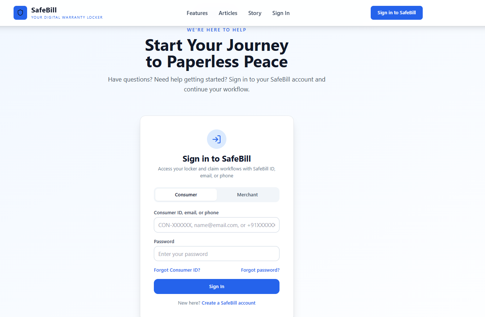
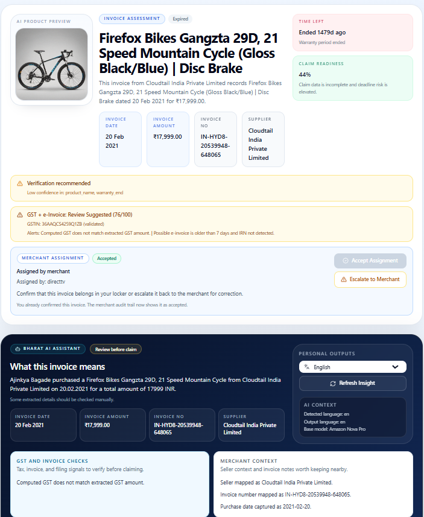

# SafeBill

SafeBill is a warranty locker and invoice intelligence platform that helps consumers and merchants store bills, extract structured data, and stay ahead of warranty deadlines. The repo is a monorepo with a Next.js web app and a FastAPI backend.

## Demo

**Click the image above to watch the demo on YouTube**

## Product Snapshots

## What It Does

- OCR and metadata extraction for invoices and warranty documents
- Consumer warranty locker with reminders and claim readiness insights
- Merchant bill assignment workflow to consumers
- AI-powered summaries and insights for invoices
- Secure document storage and sharing

## Repository Layout

- `nextjs-app/` -- Next.js app (consumer + merchant portals) and BFF `/api/*` proxy routes
- `backend/` -- FastAPI ingestion/RAG API, extraction pipeline, and notifications
- `deploy/` -- EC2 deployment assets and infrastructure references

## Tech Stack

| Layer | Service |
|---|---|
| Web app | Next.js 14 on Vercel (`nextjs-app/`), with `/api/*` routes proxying to the backend |
| Auth | Supabase Auth (email/phone + password, Google OAuth). The consumer/merchant role lives in the user's `app_metadata`, which only the server can write |
| Database | Supabase Postgres (documents, chunks, reminders, notifications, `user_profiles`) |
| Backend | FastAPI on Render (`backend/`), with an in-process worker for async image extraction and notifications |
| AI / OCR | OpenRouter (text + vision models), pdfplumber, optional Google Vision (`vision-ocr-service/`) and client-side Tesseract |
| Email | AWS SES (reminders, ID recovery), optional |

The original AWS deployment (Bedrock, S3, DynamoDB, EC2) is still available as a backend
provider option; see `backend/infra/AWS_DEPLOY.md` and `deploy/ec2/`.

## Setup

1. **Supabase**: in the SQL editor run `supabase-full-migration.sql`. On an existing project,
   run `backend/sql/008_supabase_auth_hardening.sql` instead: it moves roles into
   `app_metadata`, backfills existing users, and locks down `user_profiles`.
2. **Backend**: copy `backend/.env.example` to `backend/.env` and fill in the Supabase and
   OpenRouter values. Then `pip install -r requirements.txt` and `make run`.
3. **Web app**: copy `nextjs-app/.env.local.example` to `nextjs-app/.env.local`, then
   `npm install` and `npm run dev`.
4. **Tests**: `cd backend && python -m pytest -q` (tests never read your `.env` database or keys).

## Contributions

Contributions are welcome. Please open an issue to discuss major changes before submitting a PR. For smaller fixes, submit a PR directly with a concise description and screenshots if UI behavior changes.
